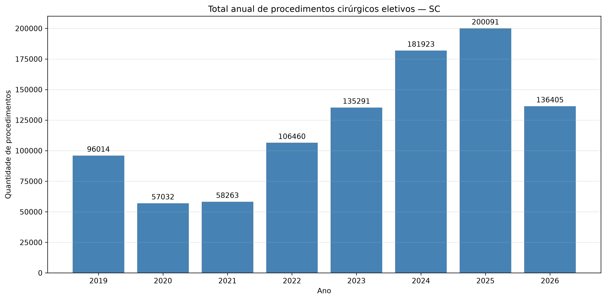

# SUSPrev SC

**Sistema de análise histórica e previsão da produção de procedimentos cirúrgicos eletivos do SUS em Santa Catarina.**

O SUSPrev SC utiliza dados do **SIH/SUS (DATASUS)** para acompanhar a produção de procedimentos e projetar os meses restantes de 2026. Seu objetivo é apoiar análises de evolução da produção assistencial e oferecer informações transparentes à população. **Não estima a fila de espera, o número de pacientes únicos ou o tempo de espera por cirurgia.**

## 1. Nome, resumo e problema abordado

A produção cirúrgica eletiva pode variar ao longo do tempo, dificultando a visualização de tendências e o planejamento. O projeto organiza registros históricos de Santa Catarina e utiliza aprendizado de máquina para estimar a quantidade de procedimentos nos meses de **setembro a dezembro de 2026**, com base nas competências observadas até **agosto de 2026**.

O resultado é uma **projeção estatística**, não uma meta oficial nem uma garantia de realização.

## 2. Origem do modelo

Modelo **XGBoost**, treinado offline com a série histórica mensal de procedimentos cirúrgicos eletivos do SIH/SUS para Santa Catarina, com atributos temporais e defasagens (lags). O artefato serializado está em `models/susprev_sp.joblib` e é carregado uma única vez na inicialização da API.

O SUSPrev SC foi desenvolvido como projeto próprio, utilizando dados históricos do Sistema de Informações Hospitalares do SUS (SIH/SUS), disponibilizados pelo DATASUS, referentes à produção de procedimentos cirúrgicos eletivos em Santa Catarina.

A base foi coletada, tratada e consolidada para construir uma série temporal mensal, utilizada no treinamento e na avaliação de modelos de Machine Learning. Após a comparação dos algoritmos, o XGBoost foi selecionado para a geração de previsões de produção cirúrgica.

## 3. Tecnologias utilizadas

Versões conforme o `requirements.txt` do repositório:

| Tecnologia | Versão | Aplicação |
|---|---:|---|
| Python | Compatível com as dependências do projeto | Linguagem principal |
| FastAPI | 0.162.0 | API HTTP |
| Pydantic | 2.14.1 | Contratos e validação de dados |
| Uvicorn | 0.54.0 | Servidor ASGI |
| XGBoost | 3.2.0 | Modelo preditivo |
| scikit-learn | 1.9.1 | Ferramentas de machine learning |
| Pandas | 2.3.3 | Processamento de dados |
| NumPy | 2.4.6 | Operações numéricas |
| Joblib | 1.6.0 | Serialização do modelo |
| pytest | 9.1.1 | Testes automatizados |
| SQLite | Integrado ao Python | Banco de dados local |

**Observação:** o frontend React está planejado, mas não faz parte da execução da API descrita nesta versão do README.

## 4. Instalação e execução

### Pré-requisitos

- Python instalado e disponível no terminal (utilizado com ambiente virtual).
- Git, para clonar o repositório, ou um ZIP extraído do GitHub.
- Conexão com a internet para instalar as dependências.

### 4.1 Obter o projeto

```bash
git clone https://github.com/Cristina-Freitas/susprev-sc.git
cd susprev-sc
git switch develop
```

**Alternativa:** baixe o ZIP da branch `develop`, extraia e abra a pasta que contém `requirements.txt`.

### 4.2 Criar e ativar o ambiente virtual

No Windows, com Git Bash:

```bash
python -m venv .venv
source .venv/Scripts/activate
```

No PowerShell:

```powershell
python -m venv .venv
.venv\Scripts\Activate.ps1
```

No Linux/macOS:

```bash
python3 -m venv .venv
source .venv/bin/activate
```

### 4.3 Instalar as dependências

```bash
python -m pip install -r requirements.txt
```

### 4.4 Reconstruir o banco SQLite

O arquivo SQLite não é versionado. Os CSVs necessários estão em `data/processed/csv_backup/`.

```bash
python scripts/backup_sqlite_csv.py restaurar
```

O comando cria `data/processed/susprev_sc.db`. **Não sobrescreve um banco já existente.** Se a restauração indicar que o banco existe, não é necessário restaurá-lo novamente; não exclua um banco sem verificar seu conteúdo.

### 4.5 Iniciar a API

```bash
python -m uvicorn app.main:app --reload
```

Acesse a documentação interativa em **http://127.0.0.1:8000/docs**.

### 4.6 Executar os testes

Com o servidor parado ou em outro terminal:

```bash
python -m pytest -q
```

Na validação realizada em **31/10/2026**, a cópia independente do projeto apresentou **46 testes aprovados e 1 aviso de depreciação**, sem falhas.

## 5. Documentação da API (Swagger / OpenAPI)

Com o servidor iniciado:

- **Swagger UI:** http://127.0.0.1:8000/docs
- **ReDoc:** http://127.0.0.1:8000/redoc
- **Especificação OpenAPI:** http://127.0.0.1:8000/openapi.json

### `GET /health`

Verifica se o serviço foi inicializado e se o modelo está carregado.

**Exemplo de resposta (HTTP 200):**

```json
{
  "status": "ok",
  "modelo_carregado": true
}
```

### `POST /predict`

Retorna os valores observados de 2026 e a projeção dos meses restantes.

**Requisição JSON:**

```json
{
  "ano": 2026
}
```

**Exemplo de resposta abreviada (totais registrados na validação da API):**

```json
{
  "ano": 2026,
  "ultima_competencia_observada": "2026-08",
  "modelo": "XGBoost",
  "total_observado": 136405,
  "total_previsto": 64765,
  "total_anual_projetado": 201170,
  "meses": [
    {"ano": 2026, "mes": 1, "quantidade": 15348, "tipo": "observado"}
  ]
}
```

**Nota:** a resposta real contém os 12 meses; o exemplo acima está abreviado. Os totais apresentados correspondem à execução validada em 31/10/2026 e podem mudar caso o modelo ou os dados sejam atualizados.

**Códigos HTTP:** `200` (sucesso), `400` (regra de negócio inválida), `422` (dados de entrada inválidos), `500` (erro interno tratado) e `503` (serviço ou banco indisponível). A documentação automática do Swagger pode não listar todos os erros tratados explicitamente no código.

## 6. Evolução anual dos procedimentos cirúrgicos eletivos



**Fonte:** gráfico original versionado em `outputs/figures/procedimentos_cirurgicos_por_ano.png`, produzido pelo pipeline de análise do SUSPrev SC a partir dos dados processados do SIH/SUS. O arquivo foi preservado sem modificações ou reconstrução. Consulte o próprio gráfico para os anos e os totais apresentados.

**Nota sobre 2026:** o histórico disponível vai até agosto de 2026. As previsões de setembro a dezembro são fornecidas separadamente pelo modelo XGBoost, por meio do endpoint `POST /predict`; não devem ser confundidas com dados observados no gráfico histórico.

## 7. Metodologia, limites e reprodutibilidade

- **Recorte:** procedimentos da série `procedimentos_sp`, associados à produção cirúrgica eletiva de Santa Catarina, conforme o processamento do projeto.
- **Unidade de análise:** quantidade de **procedimentos** registrados.
- **Fonte de dados:** SIH/SUS (DATASUS); a disponibilidade de competências depende da atualização da base utilizada.
- **Inferência:** o modelo XGBoost já treinado é carregado na inicialização da API, sem necessidade de executar `Run All` nos notebooks para consultar `/predict`.
- **Reprodutibilidade operacional:** o banco pode ser reconstruído a partir dos CSVs versionados, e a API pode ser executada a partir do ZIP do GitHub.
- **Limitação:** os resultados não medem diretamente fila de espera, demanda reprimida, desfechos clínicos ou eficiência hospitalar.

## 8. Evidências

O link do vídeo de apresentação será incluído posteriormente, conforme solicitado na entrega.

---

## 9. Autora

**Cristina Freitas**

Projeto desenvolvido para o curso **Desenvolvimento de IA para Análise Preditiva**, no programa **SCTEC**.
